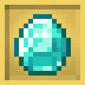
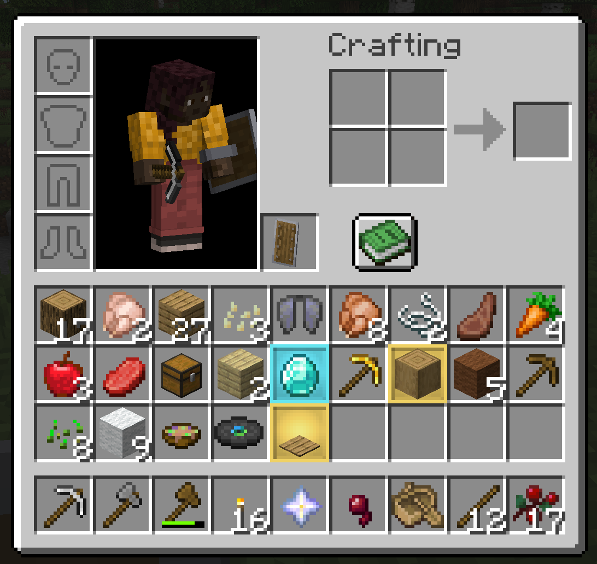
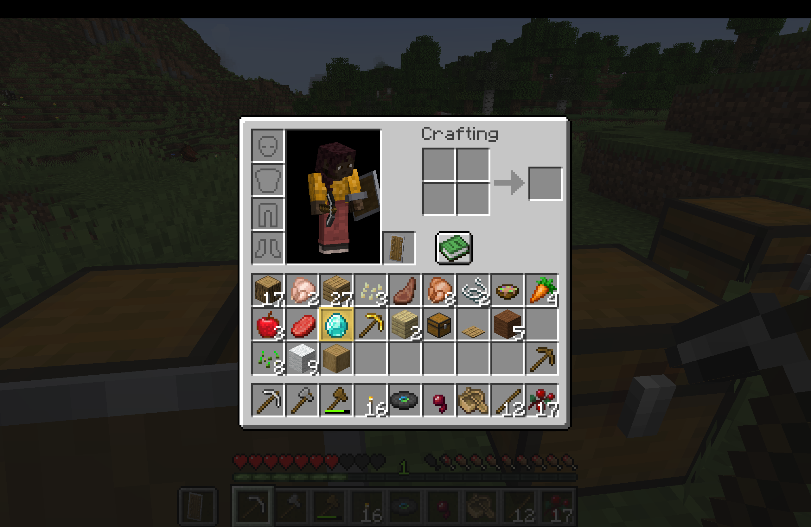

<div align="center">
  
  <h1>✨ Item Highlighter</h1>
  <p><strong>Never lose track of your picked-up items again.</strong></p>
  <p>A lightweight, cute, and aesthetic Minecraft mod that highlights newly acquired items on an illuminated, recessed 3D pedestal shelf — sitting <strong>behind</strong> your items without ever obscuring their textures.</p>
</div>

<br/>

<p align="center">
  
</p>

---

## 🛑 The Problem

Have you ever mined through a cave, explored a dungeon, or cleared your farms, only to open your inventory and wonder:  
*“Wait, where did that drop go? Which slot was it in? What did I just pick up?”*

Traditional solutions are frustrating:
- **Cluttered Icons**: Plastering bright stars or exclamation marks over the item icon obstructs the item sprite and hides stack counts.
- **Muddy Flat Overlays**: Solid tinted boxes drawn over items wash out the textures, making diamonds, tools, and potions hard to distinguish.
- **Heavy Dependencies**: Requiring multi-megabyte library frameworks just to highlight an inventory slot introduces bloat and potential lag.

---

## 💡 The Solution: Item Highlighter

**Item Highlighter** completely redesigns how inventory highlights work in Minecraft. 

Instead of slapping an overlay on top of the item, this mod renders an **illuminated, recessed 3D showcase shelf directly onto the slot background — behind the item**. Your items remain **100% visible, fully opaque, and pin-sharp**, floating above a glowing pastel pedestal!

---

## 🌟 Key Features

### 🖼️ 1. Layered Behind Items (Zero Obstruction)
The illuminated shelf is drawn directly on top of the GUI background, while vanilla Minecraft renders your item models and stack counts on top ($z=100$). Your items are never tinted, darkened, or covered up.

### 🌸 2. Clean, Neutral Pastel Yellow Default
Out-of-the-box, the mod uses a single, consistent **neutral warm buttercup yellow (`#F6D365`)** for all picked-up items. It provides a clean, welcoming glow against the dark inventory without cluttering your screen with rainbow colors unless you choose to enable them!

### 🌈 3. Optional Multicolor & Rarity Modes
Want variety? You can easily change `"colorMode"` in the config:
- **`"DEFAULT"` / `"SINGLE_COLOR"` (Default)**: Clean, uniform buttercup yellow for all items.
- **`"RARITY"`**: Colors items by their Minecraft rarity tier:
  - **Common**: Buttercup Yellow (`#F6D365`)
  - **Uncommon**: Mint Green (`#86EFAC`)
  - **Rare**: Pastel Sky Cyan (`#7DD3FC`)
  - **Epic**: Lavender Dream (`#C084FC`)
- **`"AUTO_MOD"`**: Automatically derives a unique, cute pastel color signature for each mod using HSL color science!
- **`"MOD"` & `"ITEM"`**: Set custom hex colors per mod ID (e.g. `create`, `botania`) or exact item ID (e.g. `minecraft:diamond`).

### 📐 4. Recessed Inset 3D Depth
- **Prominent Translucent Border**: An ~85% opacity outer frame on the inventory plane that clearly outlines the slot. When **multiple adjacent slots** are highlighted at once, each slot remains distinct and sharply separated.
- **Inset Recess Shading**: Uses authentic Minecraft GUI lighting conventions (inner shadow along the top/left edges and soft lip highlights on the bottom/right) to make the slot look like an illuminated showcase compartment recessed into your inventory panel.

### 🖱️ 5. Smart & Intuitive Mark Clearing
The highlight stays visible until you interact with it:
- **Hover to Clear**: Simply moving your cursor over the slot clears the highlight.
- **Click to Clear**: Clicking or moving the item clears the highlight.
- **Hotbar Auto-Clear**: Selecting the slot on your hotbar clears the highlight.
- **Automatic Cleanup**: If an item is consumed or removed from the slot, the highlight vanishes immediately.
- **Optional Close-Clear**: Option to clear all marks upon closing your inventory.

### ⚡ 6. Zero Lag & Zero Dependencies
- **100% Self-Contained**: No external libraries (no Iceberg or heavy API wrappers required).
- **Procedural Runtime Generation**: No heavy static textures or AI images. Textures are mathematically generated on-demand and cached in an OpenGL `DynamicTexture`, consuming practically zero CPU during gameplay.

### 🌐 7. Universal Client & Dedicated Server Safe
- Configured with `"environment": "*"` in `fabric.mod.json`.
- All client rendering logic and mixins are strictly isolated.
- **Dedicated servers will never crash with `NoClassDefFoundError`**! Server admins can safely drop the JAR into the server `mods/` folder, and clients connecting with or without the mod will experience seamless gameplay.

---

## 🎮 In-Game Showcase

<p align="center">
  
</p>

---

## ⚙️ Configuration (`config/item_highlighter.json`)

The config file is generated automatically in your `.minecraft/config` folder upon first launch. Every setting can be easily customized with standard hex codes:

```json
{
  "colorMode": "DEFAULT",
  "defaultColor": "#F6D365",
  "modColors": {
    "minecraft": "#F6D365",
    "create": "#FB923C",
    "farmersdelight": "#86EFAC",
    "botania": "#7DD3FC",
    "jei": "#C084FC"
  },
  "rarityColors": {
    "COMMON": "#F6D365",
    "UNCOMMON": "#86EFAC",
    "RARE": "#7DD3FC",
    "EPIC": "#C084FC"
  },
  "itemColors": {
    "minecraft:diamond": "#67E8F9",
    "minecraft:golden_apple": "#FCD34D",
    "minecraft:netherite_ingot": "#E879F9",
    "minecraft:totem_of_undying": "#FACC15"
  },
  "borderAlpha": 0.85,
  "insetShading": true,
  "shelfDepth": true,
  "haloEffect": true,
  "centerGoldAccent": true,
  "faintGlowIntensity": 0.20,
  "pulseEffect": true,
  "clearOnHover": true,
  "clearOnClick": true,
  "clearOnSelect": true,
  "clearOnInventoryClose": false,
  "showOnHotbar": true
}
```

### Color Mode Options (`colorMode`)

| Mode | Description |
|---|---|
| **`"DEFAULT"`** *(Default)* | Highlights every picked-up item with the single, uniform `defaultColor` (`#F6D365`). |
| **`"RARITY"`** | Colors slots according to the item's Minecraft Rarity using `rarityColors`. |
| **`"AUTO_MOD"`** | Automatically generates a unique cute pastel color for every mod namespace. |
| **`"MOD"`** | Uses explicit colors defined in the `modColors` map. |
| **`"ITEM"`** | Uses exact item ID overrides from `itemColors`, falling back to `modColors`, then `defaultColor`. |
| **`"ITEM_NAME"`** | Matches the custom dyed or formatted tooltip name color of the item. |

---

## 📥 Installation

1. Make sure you have **[Fabric Loader](https://fabricmc.net/)** (or **Quilt**) installed for Minecraft **1.21 / 1.21.1**.
2. Download the latest **`item-highlighter-1.0.0.jar`**.
3. Place the `.jar` file into your `.minecraft/mods` folder.
4. Launch the game and enjoy a clean, aesthetic inventory!

---

## 🛠️ Building From Source

```bash
# Clone the repository and navigate into the folder
cd item-highlighter

# Compile and package the mod JAR
./gradlew build
```
The compiled JAR will be located in `build/libs/item-highlighter-1.0.0.jar`.

---

## 🏷️ Keywords & Search Tags
`item highlighter`, `inventory highlight`, `new item marker`, `item pickup indicator`, `aesthetic inventory`, `pastel ui`, `cute minecraft mod`, `inventory hud`, `quality of life`, `qol`, `inventory management`, `loot indicator`, `item tracker`, `client-side mod`, `vanilla plus`, `fabric 1.21`, `fabric mod`, `slot highlight`, `recent items`, `minecraft loot helper`.
